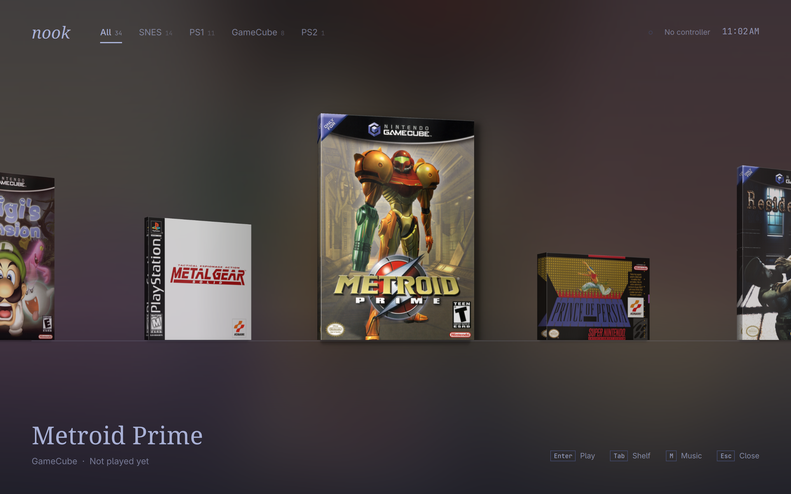
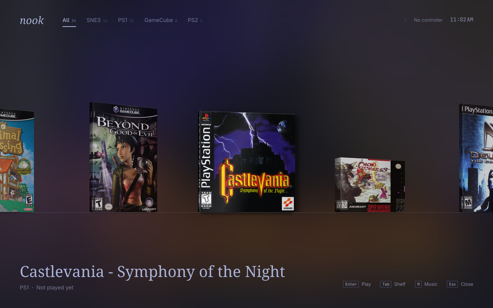
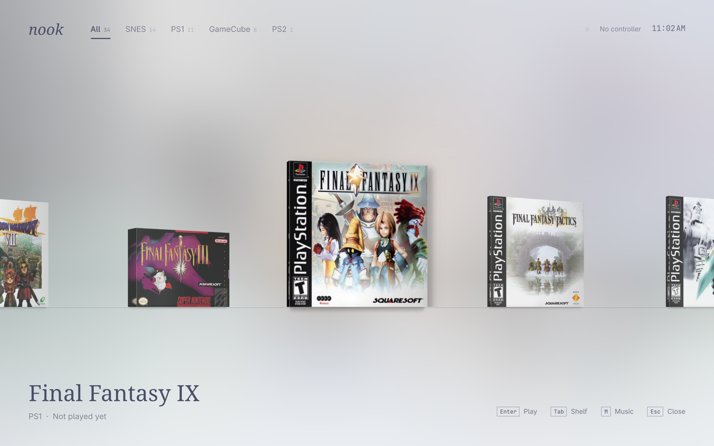
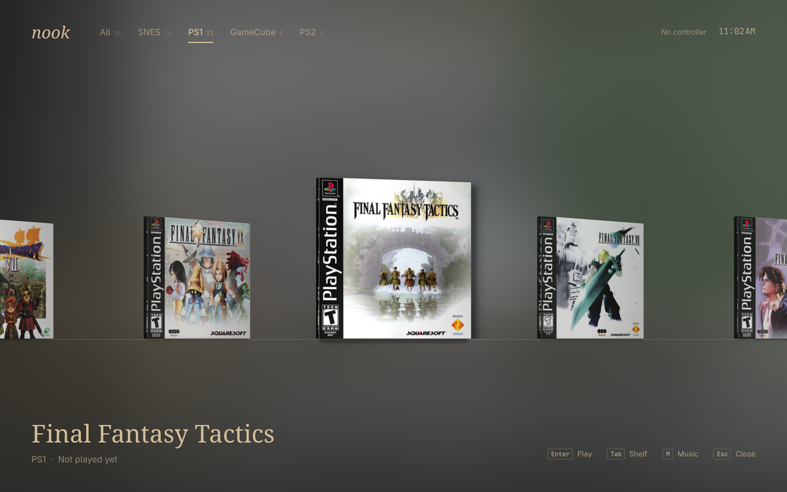
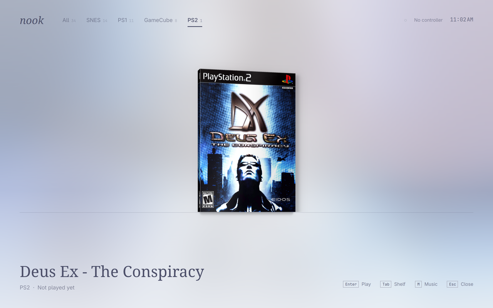
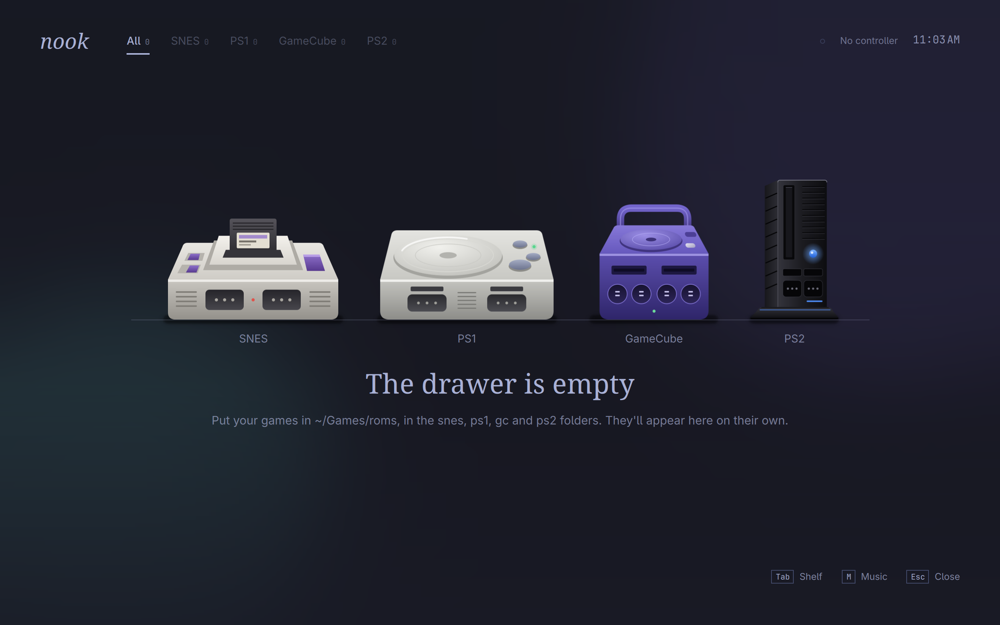

# Nook

**A calm little drawer for your retro games.**

SNES, PS1, GameCube and PS2 on one shelf, driven from the couch with a controller, wearing your Omarchy theme. Pick a box, press A, play. Leave the game and the drawer is right where you left it.



## What it's like

- **Real boxes on a real shelf.** Every game is a 3D box with a spine cut from its own cover. SNES boxes are deep cardboard, PS1 games are slim shiny jewel cases.
- **A room that follows the game.** The background is the cover blurred down to pure colour. Scroll fast and it melts through every game you pass, then settles on the one you stop at.
- **Your theme, live.** Light or dark, it follows Omarchy's colours and changes the moment you switch themes.
- **Soft sounds.** A quiet metallic ring between games and a deeper one between shelves, all generated from scratch by `bin/make-sounds`. Optional ambient music too.
- **Controller first.** Everything works from the pad, and the keyboard works just as well. 8BitDo pads confirm with A, the way they're labelled.
- **Drop in and go.** Put a game in a folder and it appears. Box art finds itself.

| | |
|---|---|
|  |  |
|  |  |

Nothing here yet? The consoles wait on the shelf, and each one links to its own shelf.



## Getting started

Nook is built for [Omarchy](https://omarchy.org) on Arch Linux, and needs Qt 6 and SDL3.

```sh
git clone https://github.com/WilliamJohnDavisIII/nook
cd nook
bin/install
```

It's then in your app launcher. For a shortcut, add this to `~/.config/hypr/bindings.lua`:

```lua
o.bind("SUPER + N", "Game drawer", { launch = "nook" })
```

To stop the layout resizing as it opens, and keep ARMSX2 fullscreen with the screen awake, add these to `~/.config/hypr/hyprland.lua`:

```lua
o.window("^nook$", { fullscreen = true })
o.window({ class = "(?i)^(armsx2|pcsx2).*" }, { fullscreen = true, idle_inhibit = "fullscreen" })
```

Nook doesn't come with any games or BIOS files. Bring your own:

```text
~/Games/
├── roms/
│   ├── snes/      .sfc .smc .swc .fig .bs .st .zip .7z
│   ├── ps1/       .cue .chd .m3u .pbp .ccd .toc
│   ├── gc/        .rvz .gcz .gcm .iso .ciso .wbfs .wia .tgc .m3u
│   └── ps2/       .iso .chd .cso .zso .cue .bin .mdf .nrg .gz
├── bios/
│   ├── scph5501.bin     PS1 (or scph5500, scph5502)
│   └── ps2/             any PS2 BIOS, unzipped
├── art/<system>/        your own covers (optional)
└── music/               ambient music (optional)
```

A game with its discs in a `.m3u`, or its tracks in a `.cue`, shows up once. So do games with loose files named `(Disc 1)`, `(Disc 2)` in one folder.

### Games on more than one disc

The discs fan out from behind the case when you land on the game. Press Play to carry on, or open the case with the left button or `D` to boot straight into any disc.

| System | When the game asks for the next disc | Saves across discs |
|---|---|---|
| GameCube | Dolphin changes it for you | Shared |
| PS1 | Change it in RetroArch's menu: Home, then Disc Control | Shared, one memory card per game |
| PS2 | ARMSX2 can't swap from here: save, leave, and boot the next disc | Shared |

Nook keeps playlists for loose discs in `~/.local/state/nook/`. To boot a PS1 game on a chosen disc, it updates RetroArch's own last-disc note, the `.ldci` file beside your saves. It never touches the saves themselves.

## The emulators

| System | Runs on | Install | Status on an Apple M1 |
|---|---|---|---|
| SNES | RetroArch, `snes9x` | `omarchy-install-gaming-retroarch` | Working |
| PS1 | RetroArch, `mednafen_psx_hw` | The same | Working |
| PS2 | [ARMSX2](https://github.com/ARMSX2/ARMSX2) on ARM | AppImage in `~/.local/opt/armsx2/` | Runs like a dream |
| GameCube | Standalone Dolphin if installed, else RetroArch's `dolphin` core | `yay -S dolphin-emu-git` | **Not working yet** |

**GameCube on Apple Silicon:** RetroArch's Dolphin core crashes at startup here because its Vulkan renderer fails, and this RetroArch build has no desktop OpenGL to fall back on. Nook prefers standalone Dolphin when it's installed, but that route hasn't been run on real hardware yet. On other machines, the core needs Dolphin's `Sys` folder at `~/Games/bios/dolphin-emu/Sys`.

For ARMSX2, use the build for your memory page size: `16K-pages` on Asahi Linux, `4K-pages` on most other ARM systems. Nook picks the matching one, and the newest if you have several.

If something's missing when you try to play, Nook tells you what.

## Controls

| Action | Controller | Keyboard |
|---|---|---|
| Choose a game | D-pad or left stick | `←` `→` or `H` `L` |
| Play | A on 8BitDo pads, the bottom button on others | `Enter` or `Space` |
| Choose a disc | Left button | `D` |
| Change shelf | Shoulders, or up and down | `Tab` or `↑` `↓` |
| Music on or off | Top button | `M` |
| Help | Start | `F1` or `?` |
| Close the drawer | B on 8BitDo pads, the right button on others, then confirm | `Q` |
| Leave a game | Hold Select + Start for a second | |

### 8BitDo Pro 2

Use X mode, with the switch on the back. RetroArch can load this pad as an "8BitDo M30", which scrambles the shoulders and triggers, because the M30's profile claims the same device ID. To fix it, point `joypad_autoconfig_dir` at your own copy of the profiles, leave out `8BitDo_M30_BT_X.cfg`, and uncomment `input_product_id` in `8BitDo_Pro2_BT_X.cfg`.

## Box art

Art comes from [libretro's thumbnail server](https://thumbnails.libretro.com), so each game's file name is sent there the first time Nook sees it. Nook tries the likely names first. If those miss, it reads the server's list for that system and picks the closest match, ignoring naming style: `final_fantasy_7` finds `Final Fantasy VII`. It matches whole words only, so `Dragon Quest V` can't become `VI`.

Covers are cached in `~/.cache/nook/`. A game with no match gets a drawn cover and tries again after a week. Your own picture at `~/Games/art/<system>/<file name>.png` (or `.jpg`, `.jpeg`, `.webp`) always wins.

## Music

Off by default. Put an audio file in `~/Games/music/` and press `M` or the top button. It fades out when a game opens.

## Command line

```sh
nook                # open the drawer
nook --windowed     # open in a window
nook check          # list every game and whether it can start
nook check --json   # the same, for a script
```

Set `NOOK_GAMES_DIR` to use a folder other than `~/Games`. If your desktop has animations turned off, Nook stills its motion too, or set `NOOK_REDUCED_MOTION=1`.

Nook never changes your game files. Recently played games come first, and that history is kept in `~/.local/state/nook/`.

## Building

```sh
bin/build         # build/nook
bin/test          # tests, offscreen
bin/install       # builds the package and installs it
bin/make-sounds   # regenerates the sounds in src/sounds/
```

## License

Nook's code is [MIT](LICENSE). The console drawings and sounds are original to this project. The games, box art and console names shown in the screenshots belong to their owners.
