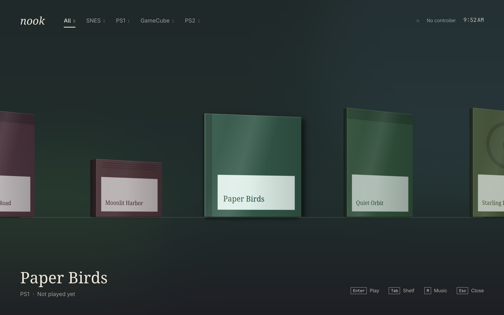

# Nook



A calm little drawer for your retro games. One shelf for SNES, PS1, GameCube and PS2, driven from the couch with a controller, in your Omarchy theme.

Put games in `~/Games/roms/<system>/` (`snes`, `ps1`, `gc`, `ps2`) and they appear on their own. Each one opens straight into its emulator, and the drawer comes back when you leave.

| Action | Controller | Keyboard |
|---|---|---|
| Choose a game | D-pad or left stick | `←` `→` |
| Play | A on 8BitDo pads, the bottom button on others | `Enter` or `Space` |
| Change shelf | Shoulders, or up and down | `Tab` |
| Music | Top button | `M` |
| Help | Start | `F1` or `?` |
| Close the drawer | B on 8BitDo pads, the right button on others, then confirm | `Q` |
| Leave a game | Hold Select + Start for a second | |

## What it needs

- **SNES, PS1, GameCube:** RetroArch with `snes9x`, `mednafen_psx_hw` and `dolphin` cores. On Omarchy: `omarchy-install-gaming-retroarch`.
- **PS1:** a BIOS such as `~/Games/bios/scph5501.bin`.
- **GameCube:** standalone Dolphin (`dolphin-emu`) if it's installed, which Apple Silicon needs. Otherwise the RetroArch core, with Dolphin's `Sys` folder at `~/Games/bios/dolphin-emu/Sys`.
- **PS2:** an ARMSX2 AppImage in `~/.local/opt/armsx2/`, and a BIOS in `~/Games/bios/ps2/`.

Nook never changes your game files. If something's missing, it says what when you try to play.

## Box art

Art comes from [libretro's thumbnail server](https://thumbnails.libretro.com) by file name, so each game's file name is sent there the first time it's seen. Art is cached in `~/.cache/nook/`. Your own picture at `~/Games/art/<system>/<file name>.png` always wins, and a game with no art gets a drawn cover.

## Music

Off by default. Put an audio file in `~/Games/music/` and press the top button or `M`.

## Checking your library

`nook check` lists every game and whether it can start, without opening a window. Add `--json` for a script to read.

## Building

```sh
bin/build     # build/nook
bin/test      # tests, offscreen
bin/install   # builds the package and installs it
```

Needs Qt 6 and SDL3.
